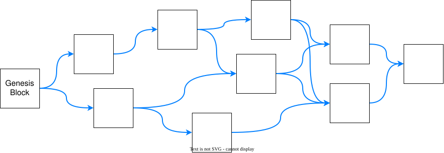

# System Overview

## Introduction

Walytis' distributed databases are implemented as non-linear blockchains.
Peers can add data at any time, but cannot change or delete existing data.

Blockchain applications are software that run locally on individual peers' host machines.
Applications can create new blockchains at any time for any use-case they require, independently of peers.
Applications read and create blocks, freely defining block content and custom metadata.

## Block Chaining

Blockchains quantise data into blocks.
Consecutively created blocks are linked together cryptographically: the child block incorporates in its metadata a cryptographic hash of the previous block's content and metadata.

The chaining of blocks serves multiple purposes:
- Because new blocks reference old blocks, the existence of old blocks cannot be forgotten.
- Basic fraudulent manipulation of existing blocks can easily be detected, because the manipulated block would have a different hash than the hash recorded in its children.

### Non-Linear Block Chaining

 To allow different nodes to add data to a database simultaneously, blocks on a Walytis blockchain can have multiple children.
 
 

Any given set of blocks are considered to be concurrent, or created simultaneously, if none if them contains the other in their ancestry, even if the exact wall-clock times of their creation is different.
If in any given pair of blocks one contains the other in its ancestry, it is known to have been created later, establishing a clear and demonstrable chronological relationship.
Walytis does NOT track wall-clock time.

Concurrent blocks are called _cousin blocks_.
A subset of this relationship is _sibling blocks_, meaning blocks that have the exact same set of parents.

## Block Constituents

In brief, the main constituents of a block are:
- user/application-defined content
- user/application-defined metadata
- Walytis-defined metadata:
	- parent block hashes
	- content hash
	- hash of all of the above
- The above are encoded into a block-file, which is a file containing all of a block's data.
- The block's identifier comprises all of its metadata.

## Block Validity

Block validity is decided by each peer independently according to the following rules:
- All hashes in the metadata must match the appropriate block constituents.
- A genesis block has zero parents, all other blocks have at least one.
- Parents must be validated blocks.
- Parents must be cousins.

## Creating a Blockchain

The essential step in creating the blockchain is creating the genesis block.
Additionally, runtime and storage infrastructure such as block storage and networking are initialised.

The genesis block's identifier becomes the blockchain's identifier.
Since block identifiers are deterministically derived from block metadata and content, the blockchain's identifier is cryptographically linked to and defined by its genesis block.

## Creating a Block

To create a block, a peer does the following:
- The block's parents are set to all the peer's current leaf blocks, blocks of which the peer knows no children at the time.
- All hashes are generated according to the block metadata specification.
- The peer stores the block in its storage.
- At this point the block is part of the blockchain and is exposed to applications and the Networking Module. At this instant, the creator is still the only peer with knowledge of the block.
- Walytis sends an event signal to the Networking Module, informing it of the existence of the new block.
- The Networking Module shares the block with other peers.

### Receiving Shared Blocks

- When a peer receives a new block created by another peer, the Networking Module passes that block to Walytis.
- The block file is decoded into content and metadata.
- The metadata is validated against all block rules (correct hashes, valid parents).
- The peer waits until all the block's parent blocks have been validated.
- The peer adds the block to its local storage.
- The peer now has the block in its blockchain, and it is exposed to applications and the Networking Module.

## Networking

Peer discovery and block sharing are all the responsibility of a separate Networking Module and are not specified by Walytis itself.
Here is an overview of how Walytis is designed to interface with the networking module.

### Block Sharing

Each peer maintains its own set of known and validated blocks, and that set grows as blocks are created locally or received from other peers.

Different peers having different numbers of blocks on their blockchain is not considered problematic.
It occurs whenever peers create new blocks and might persist due to peer connectivity issues and block sharing has latency.

What would be considered a conflict is if different peers were to associate different ancestries with the same block.
Walytis' system of chaining blocks and structuring block metadata is designed to make this negligibly unlikely to occur by accident and unfeasible to engineer deliberately.

The networking processes of sharing blocks lie outside they scope of Walytis itself; the Networking Module that.
Walytis provides the Networking Module with a list of blocks on the blockchain as well as event signals when it creates a new block.
On receiving a block shared by another peer, the networking module passes that block to Walytis, which checks its validity, which includes validating all its parents first.

### Peers Joining Blockchains

For a peer to begin participation in an existing blockchain, it needs a copy of the blockchain's blocks.
In theory, a copy of the genesis block is enough, relying on the Networking Module to acquire all others.
In practise, it is more efficient to start with a copy of the entire blockchain's blocks.
Walytis does not specify protocols or procedures for transmitting blockchain data to new peers for joining; these are specified by the Networking Module.

## Storage

Every peer stores blocks on its local storage.
This storage is optionally encrypted with a key that its application must keep in its own secret management.
