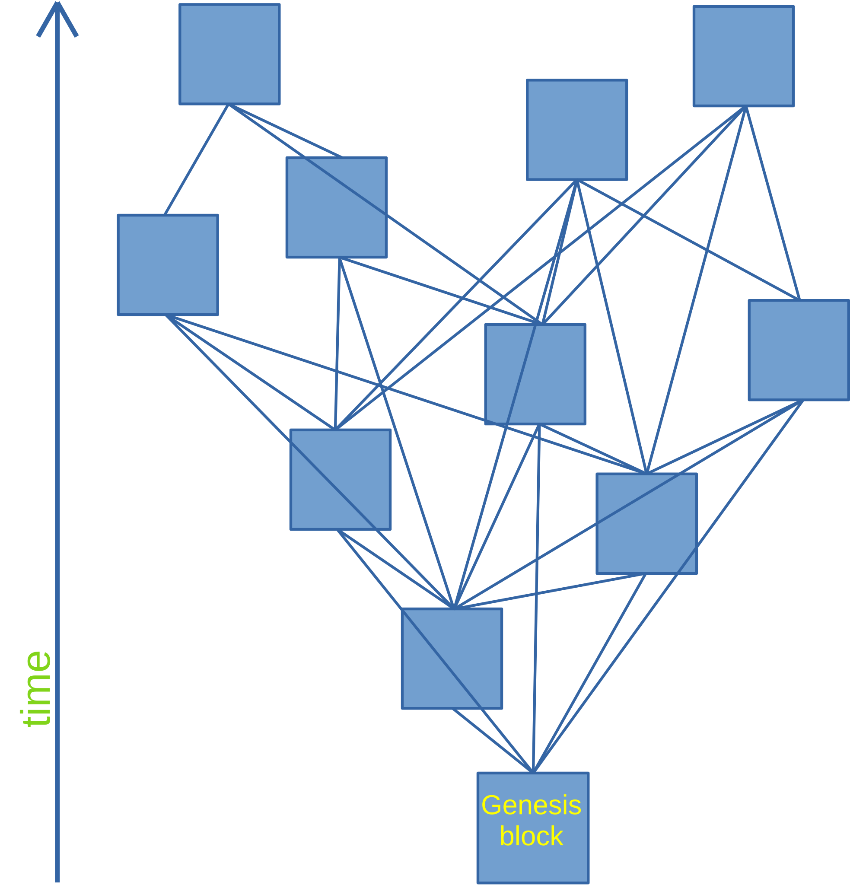

# System Overview

## Introduction

Walytis' distributed databases are implemented as non-linear blockchains.
Peers can add data at any time, but cannot change or delete existing data.

## Block Chaining

Blockchains quantise data into blocks and link those blocks together cryptographically.

The chaining of blocks serves multiple purposes:
- Because new blocks reference old blocks, the existence of old blocks cannot be forgotten.
- Basic fraudulent manipulation of existing blocks can easily be detected, because the manipulated block would have a different hash than the hash recorded in its children.

### Non-Linear Block Chaining

 To allow different nodes to add data to a database simultaneously, blocks on a Walytis blockchain can have multiple children.
 
 

## Creating a Walytis Blockchain

## Block Metadata

## Storage

