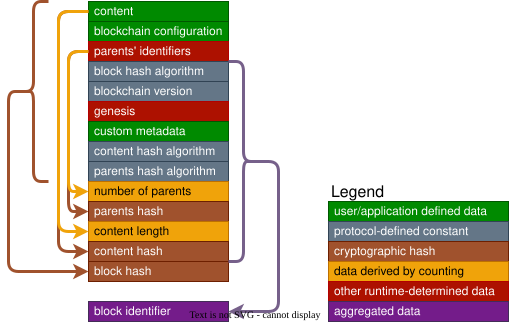

# Block Constituents — Overview

Every block IS comprised of:

- content
- [metadata](#Block%20Metadata)
- identifier

Genesis blocks ARE additionally comprised of:

- [blockchain configuration](Blockchain%20Configuration.md#Blockchain%20Configuration)

These collectively are called _block data_ or _block constituents_.
Both Block Content and Blockchain Configuration are considered payloads. Neither they nor the identifier are considered metadata.

## Block Metadata

A block's metadata IS comprised of the following fields:

| Name                     | Description                                                   | Format/Type                           |
| ------------------------ | ------------------------------------------------------------- | ------------------------------------- |
| `custom metadata`        | user/application-defined block metadata                       | bytes                                 |
| `genesis`                | flag indicating whether or not this is a genesis block        | boolean                               |
| `blockchain version`     | Walytis protocol version                                      | non-negative integer                  |
| `content length`         | number of bytes in block's content                            | positive integer                      |
| `content hash`           | cryptographic hash of the block's content                     | bytes                                 |
| `content hash algorithm` | identifier of the algorithm used to generate the content hash | [Hash Identifier](#Hash%20Algorithms) |
| `parent identifiers`     | this block's parents' identifiers                             | ordered list of Block Identifiers     |
| `number of parents`      | how many parents this block has                               | non-negative integer                  |
| `parents hash`           | a cryptographic hash of this block's parents' identifiers     | bytes                                 |
| `parents hash algorithm` | identifier of the algorithm used to generate the parents hash | [Hash Identifier](#Hash%20Algorithms) |
| `block hash`             | hash of non-derivable block constituents                      | bytes                                 |
| `block hash algorithm`   | identifier of the hash algorithm used to                      | [Hash Identifier](#Hash%20Algorithms) |

## Block Constituent Derivation

The block identifier directly encodes all block metadata fields except Parent Identifiers. It does not directly encode Block Content or Blockchain Configuration. The Content Hash, Parents Hash, and Block Hash provide indirect cryptographic commitments to the corresponding data.

Some metadata fields' values are directly specified by this specification, but might change in future specifications, maintaining backward-compatibility.

The parent blocks are selected at runtime from the creating peers current list of leaf blocks.

Derived metadata fields are derived by either of the following methods:

- cryptographic hashing
- counting

The following diagram illustrates which block constituents are derived from others:

