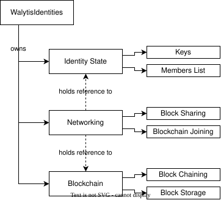
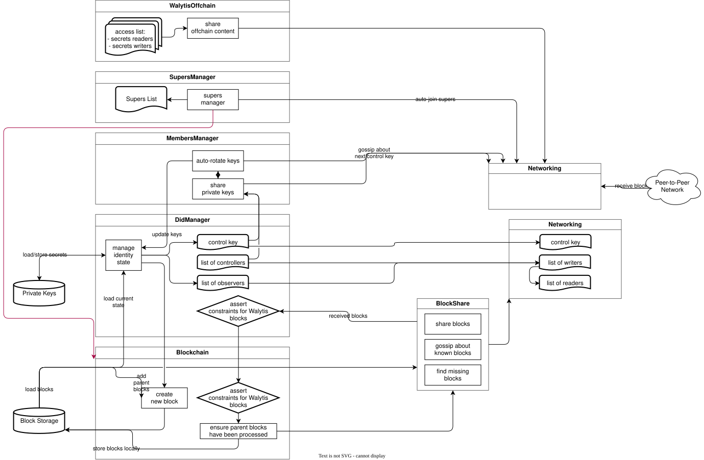

#TODO Mention W3C's DID spec?

# System Overview

## Introduction

An identity is represented by a Walytis blockchain storing its publicly verifiable identity state.
A controller is an entity (often another identity) that possesses the private credentials needed to mutate that state.

Peers, each with their own identity, use each others publicly verifiable identity states to securely communicate through WalytisNetworking, sharing verifiable updates to each others' identities' states.

An identity's public state is recorded on its own dedicated blockchain and shared by securely sharing blocks through WalytisNetworking.
Private data is stored offchain and shared separately even more securely.

## Blockchain, Identity and Networking

WalytisIdentities comprises three distinct but strongly integrated modules: the Walytis blockchain, the Identity Manager, and WalytisNetworking.
They are separated at the engineering level to maintain clear separation of concerns, but are functionally interdependent: each provides capabilities required by the others for the overall system to operate fully and securely.

### Module Roles

### Blockchain

A unique Walytis blockchain-database serves as the foundation for every identity.
The state of an identity at a given moment is determined solely from the available data on the database at that moment.
No data of [Confidentiality Level Secret](../../2.%20Endra%20Stack%20Integration%20Architecture/Security%20Model/5.%20Confidentiality%20Classification.md#Secret) is stored there.
The security guarantees the blockchain lie solely in the realm of data integrity, NOT confidentiality or authenticity.

#### Identity Manager

A subset of the identity state, the cryptographic foundation for every identity is a linear chain of rotating keys, called _identity control keys_, or simply _control keys_.
Control keys are regenerated (rotated) at regular intervals because [their security is assumed to weaken over time](../2.%20Endra%20Stack%20Integration%20Architecture/Requirements/3.%20Cryptography.md#Limitations).
Each new set of control keys is signed by its predecessor.

On generation, a control key's public part is stored on the underlying blockchain in plaintext, signed by the previous  control key.
The control key's private part is stored in a local encrypted database.

At any given point in time, the current control key is determined by the latest block in this validated chain of blocks of rotating keys.

Sharing control keys among multiple controllers is outside the scope of this layer; it is documented in [WalytisIdentities — Member Management](../6.%20WalytisIdentities%20-%20Identity%20Member%20Management/1.%20Purpose.md).

The Identity Manager is also responsible for write-protection to the blockchain, ensuring only blocks signed by a controller of the identity are written to it.

#### Walytis Networking

Walytis Networking is the communications substrate upon which the Identity Manager and its Walytis blockchain operate.
It provides secure transports for communications of [Strong Protection](../2.%20Endra%20Stack%20Integration%20Architecture/Security%20Model/6.%20Protection%20Levels.md#Strong%20Protection) between peers.
It uses the identities defined by the Identity Manager to authenticate peers and encrypt communications.
Established identities are a prerequisite for all communications.
This module is responsible for securely sharing an identity's underlying blockchain's blocks with other authorised peers as defined by the identity.
It is NOT responsible for block validity.
Its access-control provides read-protection to the blockchain and serves to combat spam, but is NOT designed to offer write-protection to the blockchain.

### Module Integration

#### Module Ownership

The Identities module creates or loads the blockchain module, loading it's identity state.
Then, it creates the networking module, giving it references to:
- its own identity state (its control key and members list)
- the blockchain

#### Information Flow

- The Identity Manager reads and writes identity state from and to the blockchain:
	- public control keys
	- access list
- The Identity Manager reads and writes secrets from and to a local encrypted database.
- Walytis Networking reads identity state from the Identity Manager:
	- control keys (public and private)
	- access list
- Walytis Networking reads blocks from the blockchain.
- Walytis Networking sends newly received, previously unknown blocks to the Identity Manager.
	

## Identity Identifier and Trust Root

The chain of rotating control keys is the beating heart of every identity. 
The first key is encoded in the identity's blockchain's genesis block's content.
Each block's identifier contains a cryptographic hash of its content.
The blockchain's identifier incorporates the identifier of its genesis block.
The identity identifier incorporates its blockchain's identifier.

Thus, any peer given the identifier of an unknown identity can challenge any other peer claiming to control that identity to prove they hold the identity's first control key.
However, since cryptographic keys are assumed to weaken over time when their public parts are published, this alone does not provide [Strong Protection](../2.%20Endra%20Stack%20Integration%20Architecture/Security%20Model/6.%20Protection%20Levels.md#Strong%20Protection) against fraud.
Therefore, out-of-band identity verification remains crucial.

## Peer Discovery

For a peer to start communicating with a new identity, that identity issues a temporary invitation code, comprising the issuing identity's identifier and its controller's current network address.
The peer uses the invitation to join communicate with identity's controller and obtain access to its blockchain.

## Conensus Systems

### Linear Blockchain

The Walytis blockchain is non-linear, allowing for blocks to be created by different peers simultaneously.
However, some mechanisms in WalytisIdentities require being declared on a linear chain. These are:
- control key history
- members list

WalytisIdentities implements a consensus mechanism to provide a linear chain of blocks to serve the above applications.
While this consensus mechanism cannot in theory completely prevent unresolved forks, it is designed to make accidental forks as unlikely as possible and engineered forks as difficult to attain as possible.

In brief, the consensus mechanism works as follows:
- The linear blockchain consists of specially marked blocks on the nonlinear blockchain.
- The linear chain of blocks records (among other things) the list of identity controllers.
- Any controller can add a new linear block at any time.
- A new linear block is at first considered a mere proposition not yet authoritative.
- Controllers vote to accept new linear blocks by recording their approval on the nonlinear blockchain. There is no disapproval vote and a vote cannot be revoked.
- Once a linear block has received votes by more than half of the controllers as recorded by that blocks ancestry, it is automatically considered enforced.
- If two linear blocks are proposed at the same time, and each get approved by more than half of the controllers, the identity is considered corrupted and is no longer usable.

### Convergence Blocks

Convergence Blocks are a set of blocks that the entire network agrees are without cousins. These provide reference points in the blockchain's history that are useful for several purposes, such as:
- fraud protection
- summarising state that would otherwise have to be read by parsing the entire blockchain history

After a network agrees on a new set of convergence blocks, they will no longer accept any new blocks that do not descend from those convergence blocks and will ensure they only communicate with other peers who also recognise those convergence blocks.
This protects against malicious actors leveraging older deprecated identity keys they have compromised.

In brief, convergence blocks are agreed upon by the following procedure:
- A convergence blocks proposal is published on the blockchain.
- Peers each cast an irrevocable vote of approval or disapproval:
	- A peer casts a vote of disapproval if it has knowledge of any other blocks that are cousins of the proposed convergence or has added another observer not on the convergence block's list of observers without giving the new peer the convergence proposal.
	- Otherwise, a peer casts a vote of approval.
- Once a peer casts a vote of approval, it will no longer accept any blocks not descending from all of the proposed convergence blocks unless another peer votes its disapproval. It will also pledge that any new peer it adds as an observer will consider itself having voted in approval.
- If all peers in the list of observers according to the proposal's ancestry accept the proposal, it is enforced.

